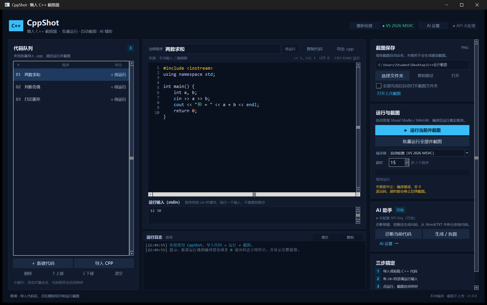
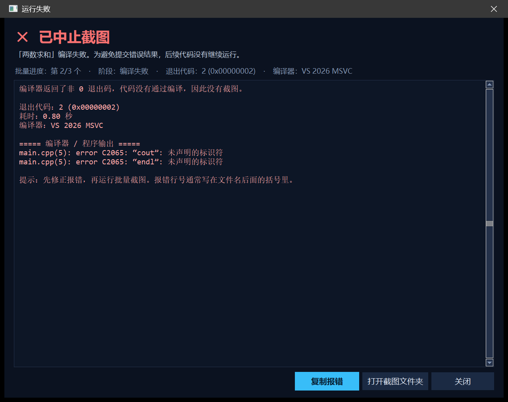
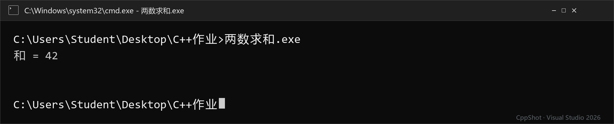
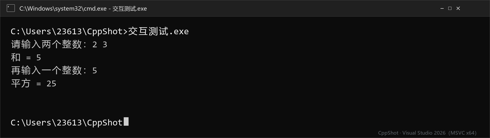

# CppShot · 懒人 C++ 截图器

> 🤖 **AI 生成说明**：本项目的代码主要由 AI 生成，作者做了人工运行验证与修复，但**不保证生产级质量**。
> 仅建议用于学习、练习和个人使用，使用前请自行审查代码；完整限制见 [VIBE-CODED.md](VIBE-CODED.md)。

> 把 C++ 代码排队、运行、截图一次做完。编译或运行失败时立即停止，并把退出码和编译器报错完整展示出来。

**GitHub 仓库：<https://github.com/OXOXice/CppShot>** · 有新的使用问题或功能建议，欢迎提 Issue。



CppShot 面向刚学 C++、需要频繁提交“运行截图”的同学：

- 一次粘贴多份代码，或一次导入多个 `.cpp` 文件
- 在程序内直接修改代码、填写 `cin` 输入
- 批量编译运行，自动保存 CMD 风格的 PNG 截图
- **交互运行**：程序实时输出，可边跑边输入，正常结束自动截图
- 遇到编译错误、非 0 退出码、超时自动中止，后续代码不再截图
- 截图保存位置可自定义，一键复制路径
- 可选 AI：诊断代码、按题目/Word 生成代码、从 Word/TXT 中拆分多段代码

## 下载与安装

### 方式一：Windows 免安装包（推荐）

在 GitHub Releases 下载 `CppShot-*-Windows-Portable.zip`：

1. 解压到任意目录（不要只把 exe 单独拖出来，它旁边的 `_internal` 文件夹也要保留）。
2. 双击 `启动 CppShot.vbs`（推荐，会自动使用程序目录内的数据和临时目录）。
3. 不需要安装 Python。

> 首次运行 Windows SmartScreen 可能提示“未知发布者”。项目目前没有代码签名证书，选择“更多信息 → 仍要运行”即可。介意的话请从源码运行或自行构建。

### 方式二：源码运行（Windows / macOS / Linux）

```bash
git clone https://github.com/OXOXice/CppShot.git
cd CppShot
python -m venv .venv
# Windows: .venv\Scripts\activate
# macOS/Linux: source .venv/bin/activate
python -m pip install -r requirements.txt
python app.py
```

要求 Python 3.10+，并额外安装 C++ 编译器。

### macOS / Linux 说明

源码层面已做了跨平台处理，仓库附带 GitHub Actions 工作流，会尝试在 Windows、macOS、Linux 上生成免安装包。但当前版本的实机测试只在 Windows 完成：

- macOS 构建产物未签名、未公证，Gatekeeper 可能默认拦截；开源侧需要使用者右键打开，正式分发需要 Apple Developer 账号。
- Linux 包是便携式 `tar.gz`，不是 `.deb`/`.rpm` 安装包；需要系统里有 Tk 运行库和 C++ 编译器。
- 非 Windows 平台的截图会使用终端风格（`user@host:path$`），不是 CMD。

## 重要：它还需要 C++ 编译器

CppShot 是“编译运行 + 截图”的图形前端，不内置编译器。第一次使用前请确保本机有：

- **Visual Studio 2019 / 2022 / 2026**，安装时勾选“使用 C++ 的桌面开发”；或
- **Visual Studio 2010**（不少国内课程还在用）；或
- **MinGW-w64**，并把 `g++` 加入 `PATH`。

打开程序后右上角会显示检测结果。没检测到就点“重新检测”。安装编译器后一般不需要重启电脑。

## 使用流程

1. **输入代码**
   - “新建代码”直接粘贴；
   - “导入 CPP”可多选 `.cpp` 文件；
   - AI 生成/拆题会作为新条目加入左侧队列。
2. **填写运行输入**（可选）
   - 程序里有 `cin` 时，在“运行输入（stdin）”按行填写，例如 `12 30`；
   - 或者使用 **交互运行**：编译后打开实时控制台，在下方输入框按 Enter，把输入一行行送进程序，像 CMD 一样。
3. **截图保存位置**
   - 默认在桌面 `C++运行截图`；
   - 点“选择文件夹”修改，“复制路径”一键复制。
4. **运行**
   - “运行当前并截图”只跑当前条目，并自动使用运行输入；
   - “批量运行全部并截图”按队列顺序执行；
   - “交互运行（边跑边输入）”打开实时控制台，适合需要多轮输入、边看提示边输入的程序；正常结束后自动保存包含输入的截图；
   - 也可以按 `Ctrl+Enter` / `Ctrl+Shift+Enter`。
5. **失败处理**
   - 编译失败、程序返回非 0、超时都会立即中止；
   - 弹窗里能看到阶段、退出代码、错误行号和完整编译器输出，可一键复制。
   - 失败的那一份**不会**生成截图，避免把错误结果交上去。

失败弹窗示例：



生成的截图文件名为 `序号_程序名_日期_时间.png`（单次运行不带序号）。

生成的实际截图示例（由真实运行输出绘制）：



交互运行会把用户输入也保留在截图里：



## 关于“截图”

CppShot 运行的是真实编译出来的程序，捕获真实 stdout/stderr。截图不是屏幕抓屏，而是把这次运行的输出按 CMD 的字体、颜色和窗口样式绘制成 PNG。这样做的好处是：

- 不会被其他窗口遮挡，批处理也不会弹一堆命令行窗口；
- 字体、行距、中文显示稳定，截图更清晰；
- 自动省略 ANSI 颜色控制符，不会把终端转义字符打印出来。

如果你的课程明确要求“屏幕原图”，请改用系统截图工具；如果只是提交运行结果，这个 PNG 完全可用。

## AI 功能（可选）

点右上角“AI 设置”填写任意 OpenAI 兼容接口：

| 配置 | 示例 |
| --- | --- |
| API 地址 | `https://api.deepseek.com/v1` |
| 模型名 | `deepseek-chat` |
| API Key | `sk-...` |

OpenAI、通义千问、Moonshot、本地 Ollama 等兼容 `/chat/completions` 的服务都可以用。可以填写自己的代理地址。

配置后可用：

- **诊断当前代码**：结合最近一次编译错误，给出初学者能看懂的解释和修复版代码；
- **生成 / 拆题**：
  - 直接粘贴作业要求，生成一份完整 C++ 程序；
  - 载入 Word/TXT，让 AI 找出文档里的多段代码，依次加入队列；
  - 未配置 API 或 AI 失败时，拆题可用本地代码块识别作为保底。

Windows 下 API Key 用当前用户的 DPAPI 加密存放在 `%APPDATA%\CppShot\config.json`，不会上传到除你配置的 AI 接口之外的任何地方。macOS/Linux 暂用本地编码保存，请不要在公共电脑上填 Key。

## 项目结构

```text
app.py                     启动入口（含 --selftest 自检）
lazycpp/
  ui.py                    主窗口、队列、批量运行
  dialogs.py               AI 设置 / 生成 / 诊断 / 失败弹窗
  toolchain.py             编译器发现、编译、运行、超时中止
  imaging.py               真实输出 → CMD 风格 PNG
  ai.py                    OpenAI 兼容接口
  documents.py             Word/TXT 读取与代码拆分
  config.py                配置、会话自动保存
  security.py              Windows DPAPI
  widgets.py               编辑器、滚动栏、异步任务
tests/                     无 GUI 核心测试
scripts/build.py           三平台免安装包构建脚本
.github/workflows/build.yml CI 构建与 Release
docs/                      截图、路线图、发布说明
```

## 从源码构建免安装包

```bash
python -m pip install -r requirements.txt pyinstaller
python scripts/build.py
```

产物在 `release/`。Windows 的 exe 使用控制台子系统启动后自动隐藏控制台：这样比 PyInstaller 的 windowed 模式在部分受限环境中更稳定，也兼容 `--selftest` 调试。

自检：

```bash
python app.py --selftest
```

## 已知限制

- 只面向单文件入门代码。多文件工程、复杂 CMake 项目、需要图形库/第三方 DLL 的代码暂不处理。
- 编译器报错使用本机语言；截图中的中文依赖系统字体。
- 程序不要等待鼠标/键盘事件，否则会超时；超时时间可调。
- 没有内置编译器，也没有内置编译器下载器。
- 目前只支持 C++；多语言扩展方案见 [多语言路线图](docs/multilanguage-roadmap.md)。

## 发布到 GitHub

仓库已附带 CI 和自动 Release 工作流。步骤：

```bash
git init
git add .
git commit -m "feat: CppShot v1.1.0"
git branch -M main
git remote add origin https://github.com/OXOXice/CppShot.git
git push -u origin main
```

打标签即可让 Actions 自动构建三端产物并创建 Release：

```bash
git tag v1.1.0
git push origin v1.1.0
```

详见 [发布说明](docs/github-release.md)。

## AI 是否必要？

我的建议是：**保留，但当作可选增强，不阻塞核心截图流程**。对大一作业，最有价值的是“从 Word 题目生成代码”和“诊断编译错误”；文档多段拆题适合批量作业。密钥、接口地址都让用户自己填，不配置也能完整使用。

## Contributors

- **OXOXice** — 项目发起人、需求提出与测试反馈
- **DeepSeek** — AI 编程助手：需求拆解、代码实现、测试与文档协作

详见 [CONTRIBUTORS.md](CONTRIBUTORS.md)。

## License

[MIT](LICENSE)
